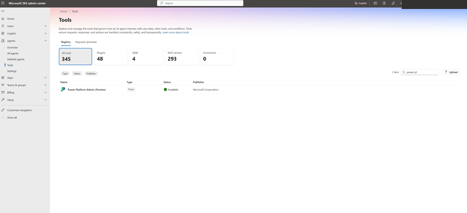
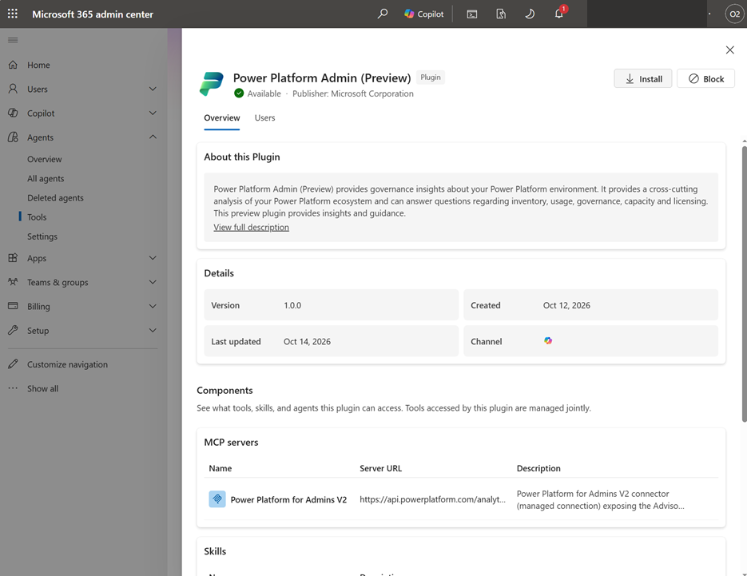
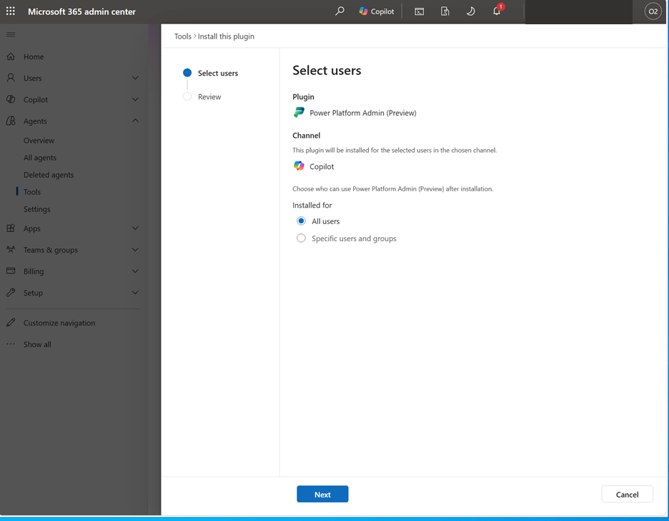
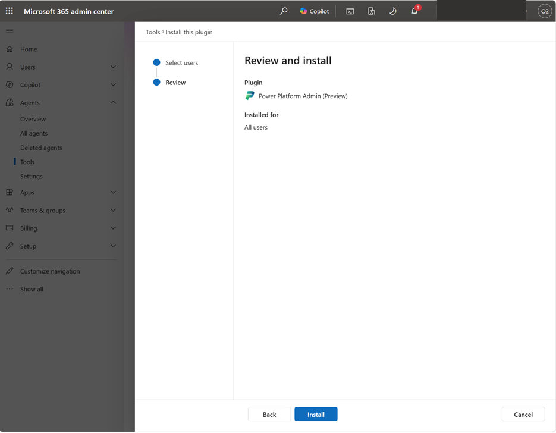
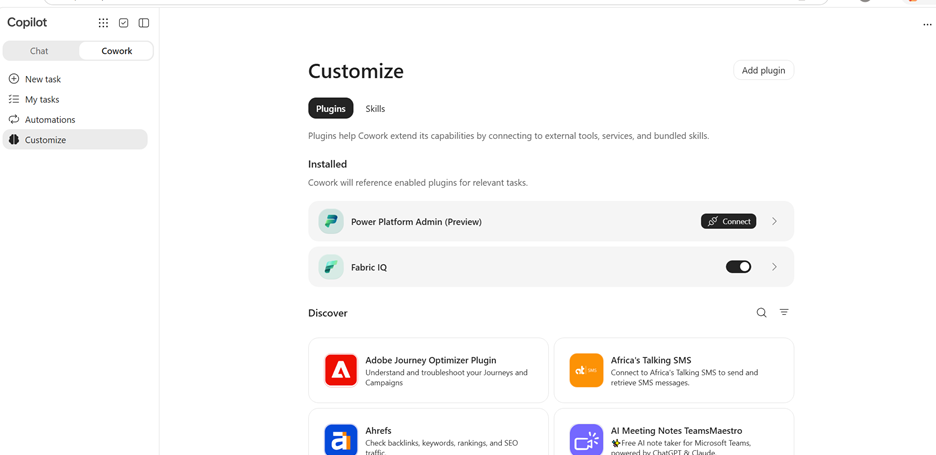
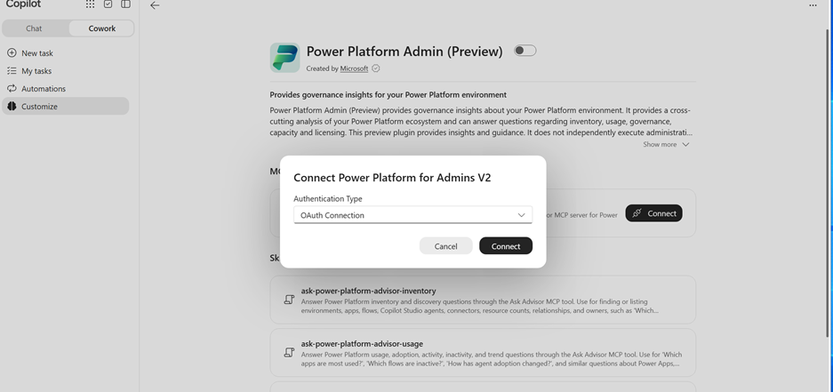
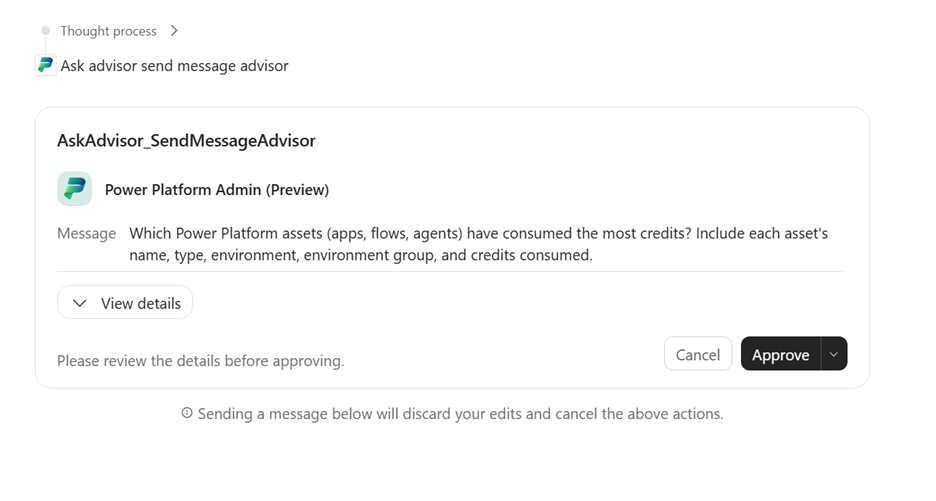
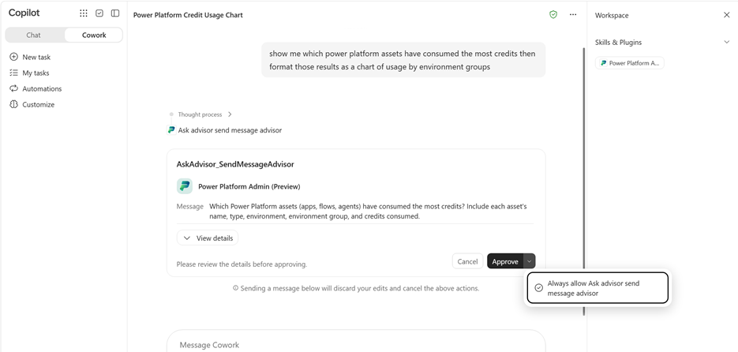

# Lab: Power Platform Admin in Cowork (Preview)

**Estimated time:** 30 to 45 minutes (plus approval time for the admin)

**Status:** Prerelease. The plugin and its steps are subject to change.

---

## 1. Lab Overview

Power Platform Admin (preview) lets you explore Power Platform resources from Microsoft Copilot Cowork. You start by asking which environments exist, then move on to inventory, usage, governance, capacity, or licensing questions.

The plugin is read-only. It gives insights and guidance, but it does not run administrative actions such as creating environments, changing settings, or deleting resources.

### Learning objectives

By the end of this lab you will be able to:

- Install the Power Platform Admin (preview) plugin for users as a Microsoft 365 administrator.
- Connect the plugin to Cowork with an OAuth connection.
- Ask read-only admin questions and approve the Ask Advisor request.
- Turn the plugin off or remove your connection when you no longer need it.
- Use the troubleshooting checklist and know what information to include in a support request.

---

## 2. Prerequisites

### Roles and access

| Task | What you need |
|---|---|
| Deploy the plugin | Tenant administrator or Copilot administrator role in the Microsoft 365 admin center |
| Connect the plugin | An active work or school account in the organization that holds the Power Platform resources |
| Use Cowork | Access to Microsoft Copilot Cowork and the plugin |
| Create the connection | Permission to create a **Power Platform for Admins V2** connection |

### Data access roles

The account you connect must have at least one of these roles:

- Global Administrator
- Power Platform Administrator
- Dynamics 365 Administrator

> **Note:** Installing the plugin does not grant any of these roles or any Power Platform data access. It also does not grant access to Cowork, which must be configured separately.

---

## 3. Part A: Install the Plugin for Users (Microsoft 365 Admin)

Complete these steps as a tenant administrator or Copilot administrator.

1. Sign in to the **Microsoft 365 admin center**.
2. Go to **Agents** > **Tools**, then select the **Registry** tab.
3. Search for and select **Power Platform Admin (preview)**, published by Microsoft.

   

4. Review the overview, then select **Install**.

   

5. On the **Select users** page, confirm that **Channel** is set to **Copilot**. Under **Installed for**, choose **All users** or **Specific users and groups**, then select **Next**.

   

6. On the **Review and install** page, confirm the audience, then select **Install**.

   

**Checkpoint A:** The plugin appears in the Tools registry with the install wizard completed for your chosen audience.

---

## 4. Part B: Connect the Plugin in Cowork (User)

Complete these steps with your work or school account.

1. Open **Copilot Cowork** and sign in with your work or school account.
2. In the Cowork navigation, select **Customize**.
3. Under **Installed**, find **Power Platform Admin (preview)**, then select **Connect**.

   

4. In the **Connect Power Platform for Admins V2** dialog, set **Authentication Type** to **OAuth Connection**, then select **Connect**.

   

5. Sign in with an account that has one of the required data access roles. Before you consent, check that the account and organization are the correct ones.
6. Return to Cowork once the connection completes.

> **Security reminder:** Never paste passwords, access tokens, or client secrets into a conversation.

**Checkpoint B:** The plugin shows as connected in Cowork, and the connected account is the one you intended.

---

## 5. Part C: Ask a Question and Approve the Request

1. In Cowork, ask:

   > *Which environments do we have, and what types are they?*

2. When the **Ask Advisor** approval card appears, select **View details**, review the request, then select **Approve**.

   

3. To go deeper, ask a follow-up question. Replace `[environment name]` with a name from the previous answer:

   > *Which apps belong to the [environment name] environment?*

### Example question topics

| Topic | Example question |
|---|---|
| Inventory | Which apps belong to the Finance environment? |
| Usage | Which apps had the most usage last month? |
| Governance | Which resources have ownership or sharing concerns? |
| Capacity | Where is Power Platform capacity being consumed? |
| Licensing | Which licensing considerations apply to this scenario? |

### Optional: Skip repeated approval prompts

If you want Cowork to remember your approval for future Ask Advisor send-message requests, open the menu next to **Approve** and select **Always allow Ask advisor send message advisor**.

> **Caution:** Use this option only if you want Cowork to remember the approval. Every future request of this type will then run without a prompt.

**Checkpoint C:** You received a read-only answer about your environments, and you can name at least one follow-up question on another topic from the table.

---

## 6. Part D: Disable the Plugin or Disconnect

Use these steps when you no longer need the plugin.

**Turn off the plugin for your conversations**

1. Open **Customize** in Cowork.
2. Select **Power Platform Admin (preview)**.
3. Turn off its switch.

> **Note:** Users cannot uninstall plugins that an administrator installed. To remove the plugin for everyone, ask your Microsoft 365 administrator.

**Disconnect your account**

1. Open the **Power Platform for Admins V2** connection settings.
2. Remove the connection.

**Checkpoint D:** The plugin is switched off or the connection is removed.

---

## 7. Troubleshooting Reference

| Symptom | What to do |
|---|---|
| Can't install the plugin | Ask your Microsoft 365 administrator to confirm your account is in the install audience and that the Copilot channel is selected. |
| Installed, but no Power Platform data | Confirm the connected account has a required role in the intended organization. |
| Plugin not listed under Installed in Customize | Ask your administrator to check the installation audience. |
| Cowork unavailable | Ask your administrator to check Cowork access separately. |
| Cowork asks you to connect | Complete the OAuth connection, then ask your question again. |
| Connected, but Ask Advisor unavailable | Report it through support, including the plugin name and the error (no credentials). |
| Wrong account or organization | Use the connection settings to select or create the correct connection, or ask an administrator for help. |
| Request is slow | Let it finish. If Cowork cannot confirm the answer, include the conversation ID in your support request, if one is provided. |

---

## 8. Getting Help

- **Account access or plugin availability:** Contact your administrator first.
- **Power Platform assistance:** Use Microsoft Support in the Power Platform admin center. A support request needs an active support plan, but self-help resources are free.
- **When reporting an issue, include:**
  - The plugin name
  - The Copilot experience you used (for example, Cowork)
  - The time and the steps you took
  - Any error message or conversation ID
  - Never include passwords, tokens, or secrets.

---

## 9. Lab Review Questions

1. Why does installing the plugin not give a user access to Power Platform data?
2. Which three roles can the connecting account use for data access?
3. What does the plugin do, and what does it not do?
4. Why should you check the account and organization before you consent to the OAuth connection?
5. What should you do if Cowork asks you to connect again after you have already connected?

---

## Appendix: Image Index

| Figure | Used in | Description |
|---|---|---|
| 1 | Part A, step 3 | Tools registry with the plugin listed |
| 2 | Part A, step 4 | Plugin overview with the Install button |
| 3 | Part A, step 5 | Select users page (Copilot channel and audience) |
| 4 | Part A, step 6 | Review and install page |
| 5 | Part B, step 3 | Cowork Customize page with Connect |
| 6 | Part B, step 4 | OAuth connection dialog |
| 7 | Part C, step 2 | Ask Advisor approval card |
| 8 | Part C, optional | Always-allow approval option |
